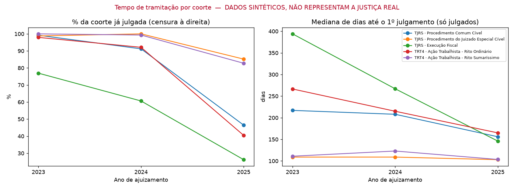
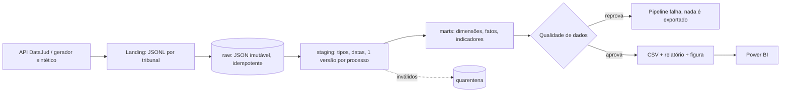

# Monitor de Tramitação Processual

Pipeline de dados ponta a ponta (Python + SQL + modelo dimensional + Power BI) que responde: **quanto tempo os processos levam até o primeiro julgamento, onde ficam parados e quanto do acervo está pendente.**



> ⚠️O repositório acompanha um **gerador de dados sintéticos** (com defeitos injetados de propósito) para rodar sem rede e para testes. A figura acima, o relatório de qualidade e todos os exemplos do README vêm desses dados e **não descrevem a Justiça real**. Para análise real, use a ingestão do DataJud (abaixo) e substitua os números.

## Status do que foi (e do que não foi) verificado

| Item | Status |
|---|---|
| Pipeline completo com dados sintéticos | ✅ executado |
| 14 testes automatizados (regras, dedup, quarentena, idempotência, fim a fim) | ✅ passando |
| Mediana/P90 do SQL conferidos contra cálculo independente em Python | ✅ 0 divergências em 15 grupos |
| Ingestão da API real do DataJud | ⚠️ **escrita, não executada** (sem rede no ambiente de construção) |
| Medidas DAX / `.pbix` | ⚠️ **escritas, não validadas** no Power BI Desktop |
| Execução em PostgreSQL | ⚠️ não testada (ver "Portar") |

## Problema de negócio
Um gestor de contencioso (cenário **fictício**) quer priorizar acompanhamento: em quais tribunais/classes o tempo até o primeiro julgamento é maior, em quais fases os processos ficam parados e quanto do acervo está sem julgamento e sem movimentação há mais de 90 dias.

## Arquitetura


## Como rodar
```bash
pip install -r requirements.txt
make demo      # pipeline completo com dados sintéticos (~2 s)
make test      # 14 testes
```
Saídas: `data/exports/*.csv` (para o Power BI), `docs/relatorio_qualidade.md`, `docs/img/tempo_por_coorte.png`.

### Com dados reais do DataJud
```bash
export DATAJUD_API_KEY=<chave pública divulgada pelo CNJ>
python -m src.pipeline.run --fonte datajud --tribunais tjrs trt4 --classes 7 1116 985 \
       --de 2023-01-01 --ate 2025-09-30 --max-docs 500 --reset
```
Comece pequeno (`--max-docs`), inspecione `data/raw/*.jsonl` e confira nomes de campos, limites e termos de uso na documentação oficial do CNJ. Se a qualidade reprovar, o relatório mostra qual regra falhou: isso é o comportamento desejado, não um bug.

## Modelo e qualidade
- Dicionário de dados: [docs/dicionario_de_dados.md](docs/dicionario_de_dados.md)
- 9 regras de qualidade (6 bloqueantes, 3 alertas), com quarentena rastreável: [docs/relatorio_qualidade.md](docs/relatorio_qualidade.md)
- Decisões e trade-offs: [docs/decisoes_tecnicas.md](docs/decisoes_tecnicas.md)
- Power BI: [powerbi/medidas_dax.md](powerbi/medidas_dax.md)

## O ponto metodológico central: censura à direita
Processos recentes ainda não foram julgados. Se a análise calcular a mediana só dos julgados, coortes recentes parecem mais rápidas do que são. Por isso os indicadores são por **coorte de ajuizamento** e sempre acompanhados de `% julgados`. Com os dados sintéticos isso é visível: a coorte 2025 de Execução Fiscal mostra mediana menor que a de 2023 apenas porque ~74% dela ainda não foi julgada.

## Limitações conhecidas
1. "Primeiro julgamento" é aproximado por **nome** de movimentação; com dados reais, mapear por código TPU e validar amostra.
2. Fuso horário ignorado (erro de até 1 dia em parte dos registros).
3. Sem análise de sobrevivência (Kaplan-Meier) ainda; seria o passo correto para estimar tempos com censura.
4. Dados públicos não refletem a carga total nem o segredo de justiça.

## Portar para PostgreSQL
`json_extract(p,'$.a.b')` → `p::jsonb #>> '{a,b}'` · `json_each` → `jsonb_array_elements` / `jsonb_array_elements ... WITH ORDINALITY` · `julianday(a)-julianday(b)` → `a::date - b::date` · `strftime('%Y',d)` → `to_char(d,'YYYY')` · `norm_ts` → função SQL/PLpgSQL · `INSERT OR IGNORE` → `ON CONFLICT DO NOTHING` · `WINDOW w AS (...)` funciona igual.

## Roadmap
Carga incremental por `dataHoraUltimaAtualizacao` · mapeamento por código TPU · Kaplan-Meier · orquestração (Airflow/cron) · versão PostgreSQL com testes em CI via serviço.
